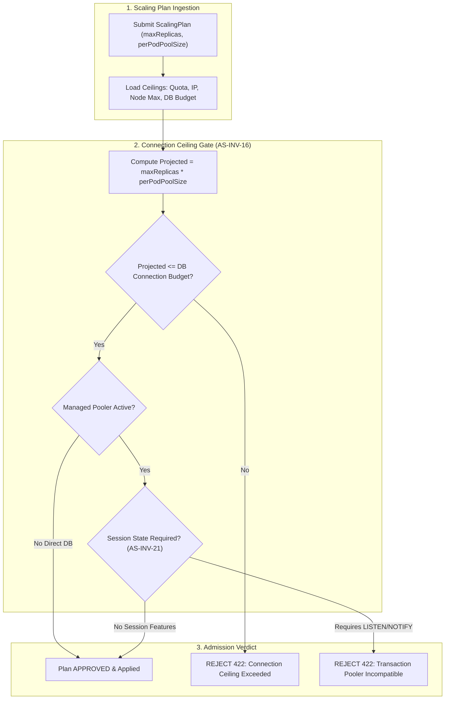
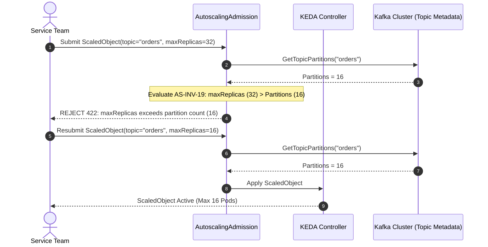
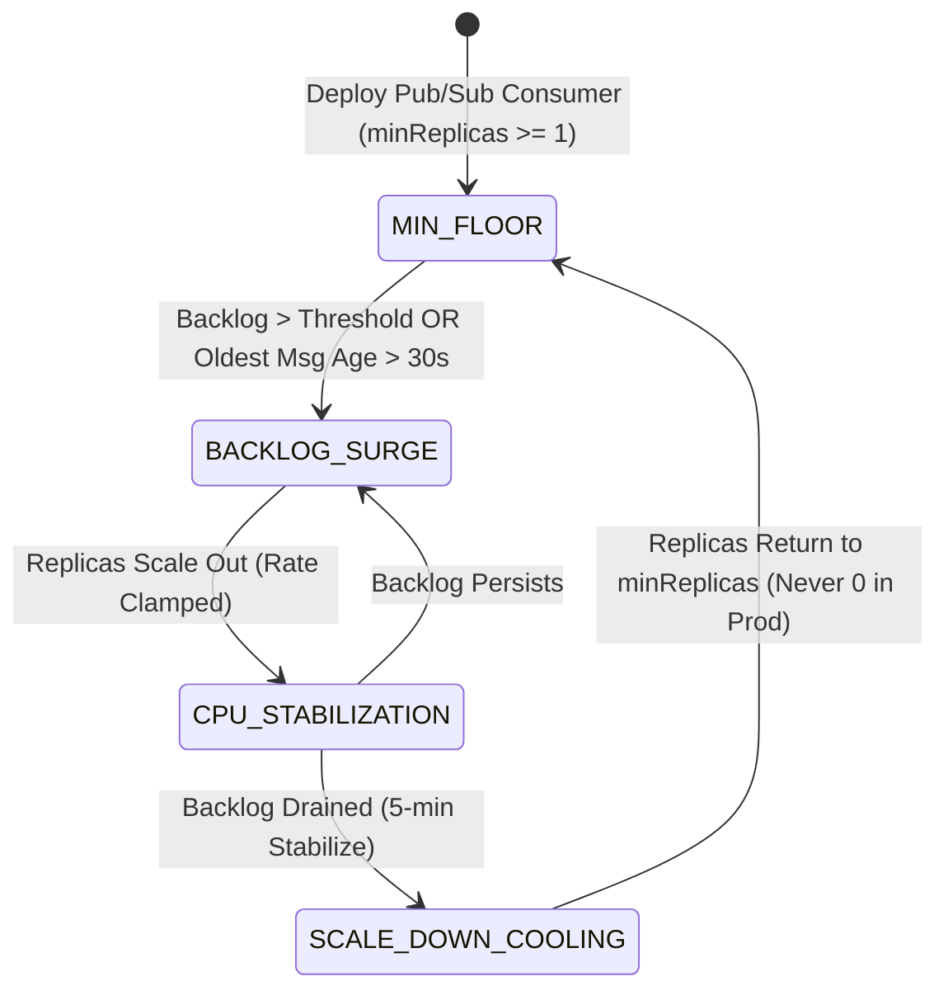

# Architecture Diagrams — Autoscaling (Phase 2 Data & Ingestion)

## 1. Database Connection Ceiling & Admission Cascade Flowchart

---

## 2. Kafka Consumer Partition Capping Sequence Diagram

---

## 3. Pub/Sub Dual-Metric Scaling & Floor State Machine

