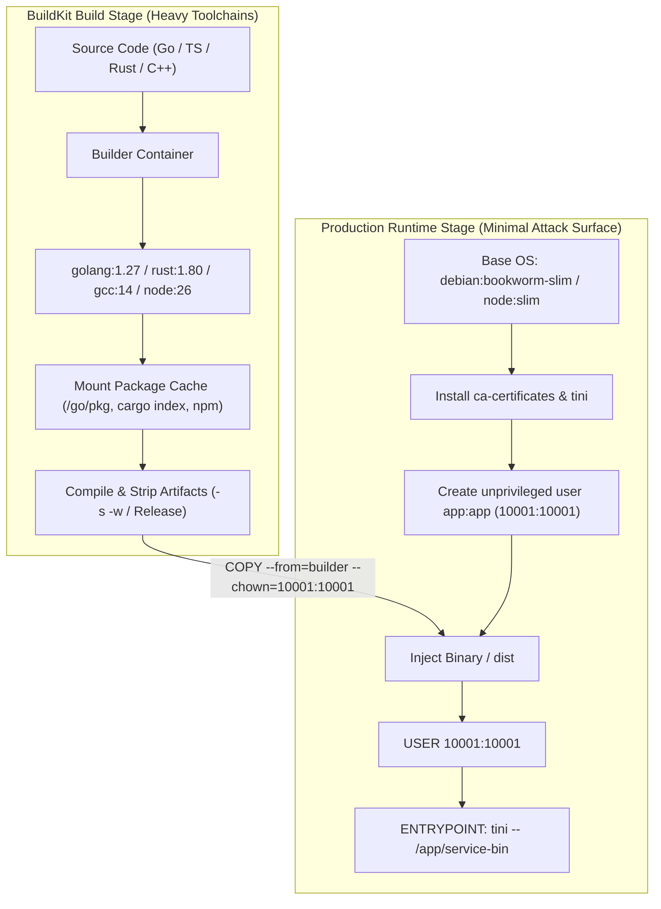
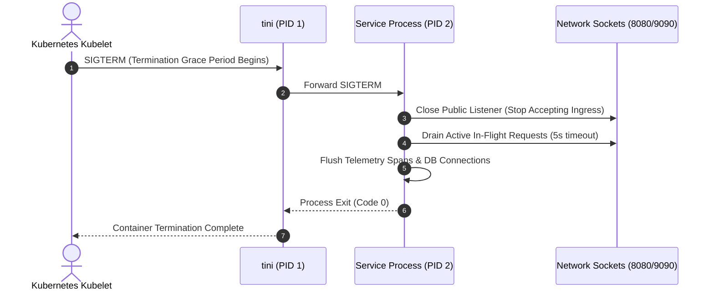
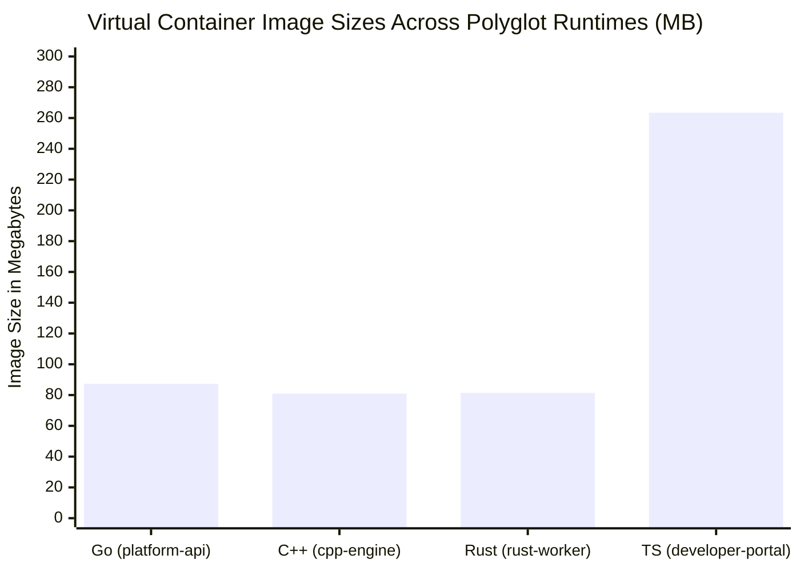

# Visual Architectural Diagrams: Container Packaging and Lifecycle

## 1. Multi-Stage Build Lifecycle Pipeline

The following flowchart illustrates the segregation between heavy SDK compiler environments and minimal runtime packaging.

---

## 2. Process Tree & Signal Propagation Lifecycle

The sequence diagram demonstrates how container init (`tini`) prevents zombie processes and guarantees clean socket draining during Kubernetes rolling updates.

---

## 3. Storage Layer Distribution & Footprint Breakdown

