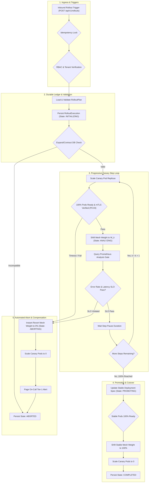
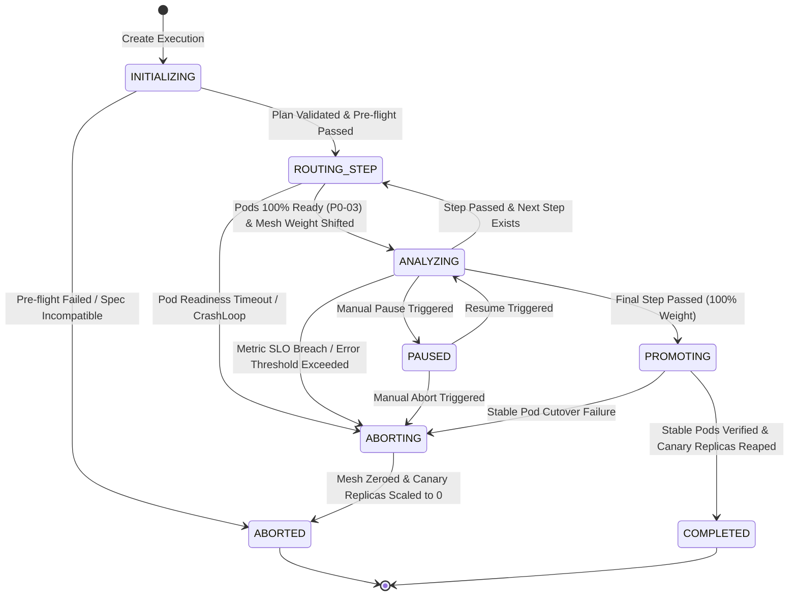
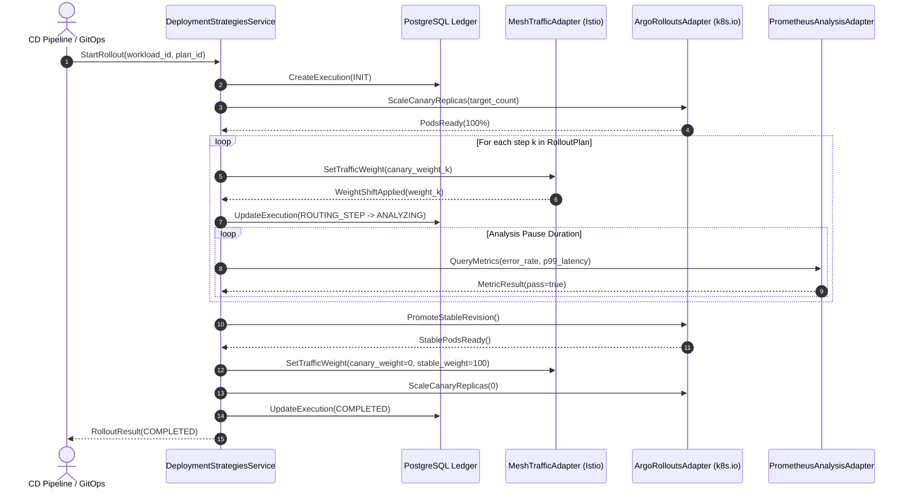
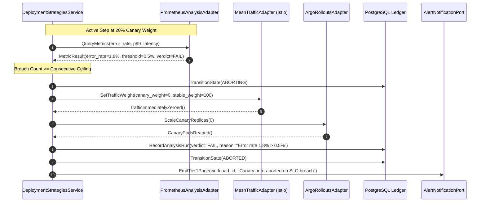

# Architecture Diagrams — Deployment Strategies

## 1. End-to-End Progressive Delivery & Traffic Shifting Flowchart

---

## 2. Rollout Execution Finite State Machine (FSM)

---

## 3. Service Mesh & Pod Replicas Traffic Allocation Sequence

---

## 4. Automated Metric Analysis & Abort Compensation Sequence

