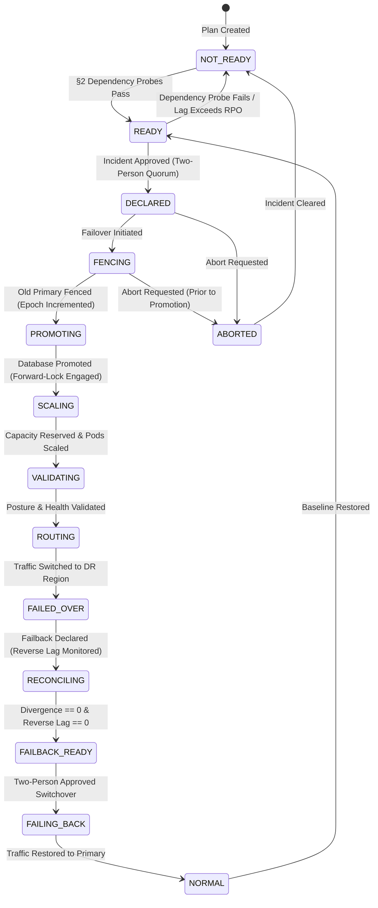
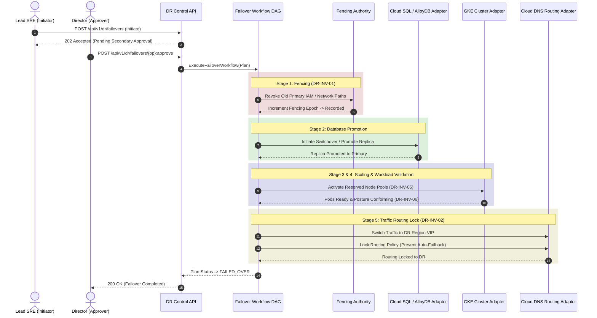
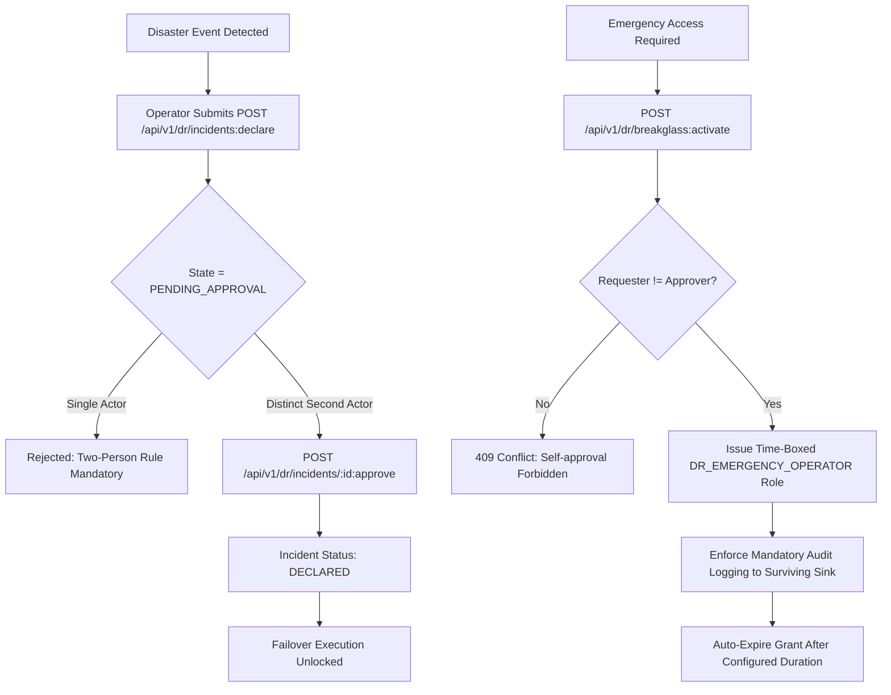

# Disaster Recovery: Architectural Diagrams

## 1. Disaster Recovery 15-State Lifecycle Machine

The DR Plan lifecycle strictly adheres to the 15-state forward-locking finite state machine. Transitions past `PROMOTING` are forward-only to prevent split-brain conditions.

---

## 2. Six-Stage Failover Execution DAG

When an authorized two-person failover is triggered, the execution workflow enforces strict dependency sequencing:

---

## 3. Two-Person Declaration & Break-Glass Gate

Stateful operations require cryptographic separation of duties:

