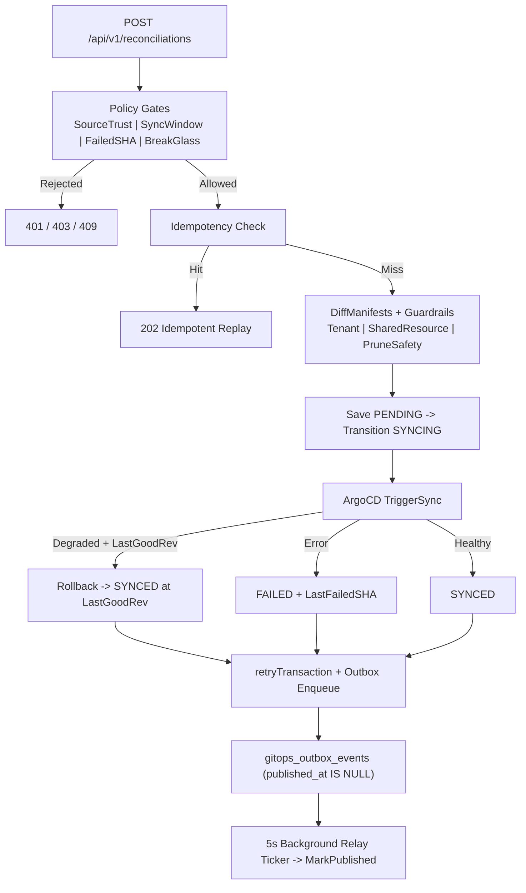
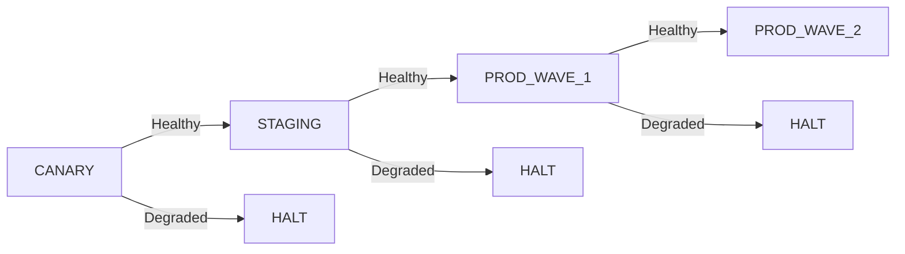

# Architecture Decision Records (ADRs): GitOps Reconciliation

## ADR-001: Argo CD as the Exclusive Single Writer for In-Cluster State
- **Status**: Accepted
- **Context**: Allowing multiple microservices or CI/CD pipelines to run `kubectl apply` directly against target Kubernetes clusters creates configuration divergence, unmanaged credentials, and state inconsistency during rollbacks.
- **Decision**: Designate Argo CD as the sole authoritative writer permitted to synchronize manifests to Kubernetes clusters (§0.17). All platform features publish declarative manifests to Git; Argo CD reconciles them continuously.
- **Consequences**: Direct cluster mutations are prohibited; cluster state is 100% reproducible from Git history; drift detection and automated self-healing are natively handled by the Argo CD Application Controller.

---

## ADR-002: Deterministic SHA-256 Merkle Tree Commit Signing for Git Manifest Publishers
- **Status**: Accepted
- **Context**: Git commits created by automated automation engines must guarantee cryptographic tamper-evidence, reproducibility, and conflict-free concurrent branch publication.
- **Decision**: Implement `src/infra/clients/gitops/committer.go` utilizing deterministic SHA-256 Merkle tree calculation across all file paths and payloads before creating signed Git commit objects.
- **Consequences**: Every manifest set is hashed deterministically; git commit trees remain verifiable against original spec inputs; audit trails satisfy strict government supply chain compliance.

---

## ADR-003: Resilient Argo CD REST Client with Exponential Backoff and State Machine Tracking
- **Status**: Accepted
- **Context**: Intermittent network latency or Argo CD server restarts during cluster maintenance can interrupt deployment status queries, resulting in false-positive deployment failures.
- **Decision**: Wrap the Argo CD REST client (`src/infra/clients/argocd/`) in the downstream resilience executor with retry budgets, circuit breakers, and explicit application sync triggering. Transition internal reconciliation records through a formal state machine (`SYNCING`, `HEALTHY`, `DEGRADED`, `UNKNOWN`).
- **Consequences**: Transient Argo CD restarts do not fail workload deployments; applications maintain clear observability into active synchronization phases.

---

## ADR-004: API-Configurable Destination-Cluster Secret Mechanism (D-SEC) & Policy-Gated Reconciliation
- **Status**: Accepted
- **Context**: Designating Argo CD as the sole writer (ADR-001) collides with storing Kubernetes `Secret` values in Git or injecting them during manifest generation, because Argo CD's `repo-server` caches rendered manifests in plaintext in Redis. Additionally, reconciliation requires explicit policy gates for signed commits (`P0-02`), sync windows, same-SHA retry prevention, and shared resource ownership.
- **Decision**:
  1. Introduce `SecretMechanismPort` and `ConfigurableSecretAdapter` (`PUT/GET /api/v1/gitops/secrets/config`, persisted in `gitops_secret_mechanisms`) so each tenant configures its destination-cluster secret controller (`SEALED_SECRETS`, `EXTERNAL_SECRETS_OPERATOR`, or `SECRETS_STORE_CSI_DRIVER`) via API.
  2. Enforce `P0-03` (`EvaluateSecretInGitOpsPath`) to block plaintext `Secret` `data`/`stringData` in Git and block generation plugins injecting secret values.
  3. Enforce `EvaluateSourceTrust` (`P0-02`), `EvaluateSyncWindow`, `ShouldRetryFailedSHA`, and `ValidateSharedResourceOwnership` (`FailOnSharedResource`) as pure domain rules.
- **Consequences**: Secret values never pass through Git or Argo CD's Redis cache; tenants can switch secret backends via API without code changes; reconciliation is deterministic, auditable, and drift-safe.

---

## ADR-005: Transactional Outbox, CAS Retry Loop, Break-Glass Auto-Sync Guard & Phase 3 Fleet Ring Rollout
- **Status**: Accepted
- **Context**:
  1. Concurrent webhooks or manual syncs for the same application can trigger optimistic-concurrency (`version`) conflicts, and terminal state transitions (`SYNCED`, `FAILED`, `ROLLING_BACK`) must emit durable domain events without dual-write loss.
  2. Break-glass emergency live-cluster fixes are overwritten by Argo CD self-heal if auto-sync is re-enabled before the fix is committed and signed in Git (Case 11).
  3. Multi-cluster fleet deployments require ring-based progression (`CANARY` -> `STAGING` -> `PROD_WAVE_1` -> `PROD_WAVE_2`) that halts automatically if any cluster reports `DEGRADED` health.
- **Decision**:
  1. **CAS Retry & Transactional Outbox**: Wrap state-mutating `store.Update` calls in `retryTransaction` (`MaxCASRetries = 3`, child span `gitops.reconciliation.retry_tx.<op>`) and emit `OutboxEvent` (`ReconciliationSucceeded`, `ReconciliationFailed`, `RollbackTriggered`) via `OutboxPort` into `gitops_outbox_events` (migration `0019`), relayed by `RelayPendingOutboxEvents` on a 5-second background ticker in `src/main.go`.
  2. **Break-Glass Guard**: Enforce `EvaluateBreakGlassAutoSyncGuard` in `evaluateReconciliationPolicyGates` to reject syncs with `409 Conflict` when `emergencyChangePending && !emergencyCommittedAndSigned`.
  3. **Phase 3 Fleet Ring Rollout**: Implement `ExecuteFleetRingRollout` and `EvaluateFleetRingHealth` to progress through rings sequentially and halt immediately on degraded cluster health.
- **Consequences**: Zero dual-write event loss, deterministic protection against self-heal reverting emergency hotfixes, and automated blast-radius containment across cluster rings.

### End-to-End Reconciliation & Outbox Architecture

### Phase 3 Fleet Ring Rollout

