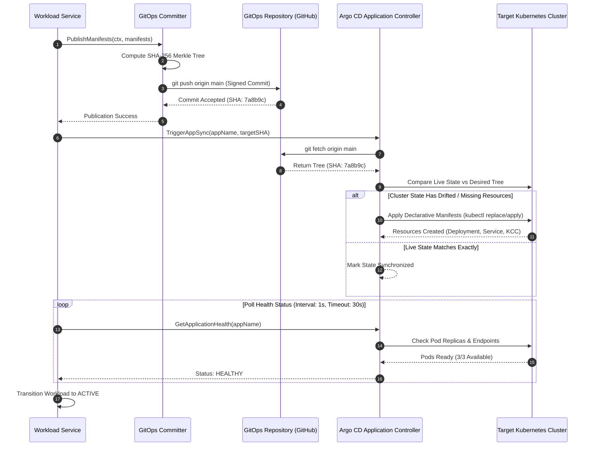
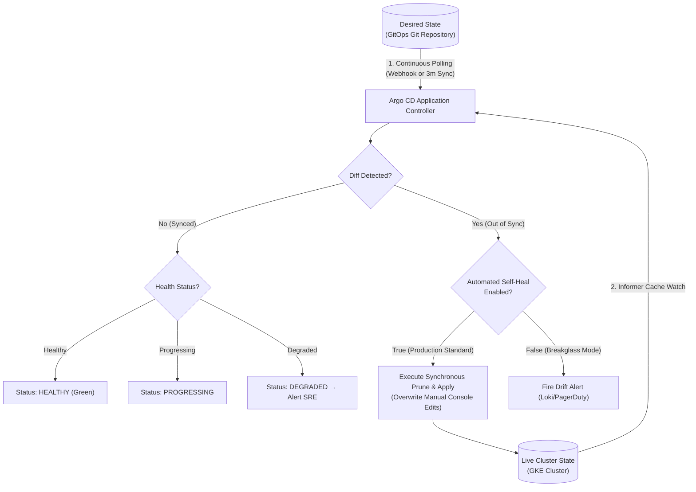

# Architecture & Operational Diagrams: GitOps Reconciliation

This document details the runtime architecture of the GitOps publisher, deterministic Merkle tree hashing, signed commit generation, and the Argo CD single-writer reconciliation loop.

---

## 1. Deterministic Merkle Tree & GitOps Publisher Runtime Execution ASCII Tree

The following ASCII tree outlines the exact cryptographic process used to publish rendered Kubernetes and Config Connector manifests to the GitOps repository:

```text
[Manifest Publication Request] : DeterministicTreePublisher.Publish(ctx, spec)
  │
  ├── 1. Distributed Tracing & Span Setup
  │     ├── Open OTel Child Span: "gitops.manifest.publish"
  │     ├── Set Attributes: repository, branch, author.email
  │     └── Defer span.End()
  │
  ├── 2. Lexicographical Sorting & Leaf Hashing
  │     ├── Sort file paths deterministically in ascending ASCII order:
  │     │     ├── Path 1: apps/{tenant}/{app}/01-namespace.yaml
  │     │     ├── Path 2: apps/{tenant}/{app}/02-kcc-iam.yaml
  │     │     ├── Path 3: apps/{tenant}/{app}/03-deployment.yaml
  │     │     └── Path 4: apps/{tenant}/{app}/04-pdb.yaml
  │     │
  │     └── For each file:
  │           ├── Canonicalize content (trim trailing whitespace, ensure trailing newline)
  │           ├── Calculate Leaf SHA-256: LeafHash = SHA256(Path + "\x00" + Content)
  │           └── Store in ordered leaf array
  │
  ├── 3. Merkle Tree Root Calculation
  │     ├── Pairwise hash leaves upwards until a single 32-byte Root Hash is computed
  │     ├── MerkleRoot = SHA256(NodeLeft + NodeRight)
  │     └── Stamp MerkleRoot onto commit metadata: "X-GitOps-Merkle-Root: <hex>"
  │
  ├── 4. Signed Git Tree Object Generation
  │     ├── Create in-memory Git blob objects for each file
  │     ├── Build Git tree object referencing blobs with deterministic mode 100644
  │     └── Generate signed Git commit object referencing parent commit SHA
  │
  ├── 5. Resilient Git Push Execution
  │     ├── Acquire Bulkhead Slot from Resilience Executor
  │     ├── Attempt fast-forward push: git push origin {branch}
  │     │
  │     ├── ↳ If Fast-Forward Rejected (Concurrent Commit Race):
  │     │     ├── Fetch latest remote branch: git fetch origin {branch}
  │     │     ├── Rebase local commit cleanly onto new remote HEAD
  │     │     ├── Recalculate commit tree with updated parent pointer
  │     │     └── Retry push using exponential backoff with full jitter
  │     │
  │     └── ⚠ On Persistent Failure / Retry Budget Exhaustion:
  │           ├── RecordError(span, pushErr)
  │           └── Return 503 DownstreamUnavailableError
  │
  └── 6. Trigger Argo CD Synchronous Sync
        ├── Invoke ArgoCDClient.SyncApplication(ctx, appName, commitSHA)
        └── Poll ArgoCDClient.GetApplicationHealth(ctx, appName) until 'Healthy'
```

---

## 2. Argo CD Single-Writer Closed Loop Sequence Diagram



---

## 3. Automated Drift Detection & Self-Healing Architecture


