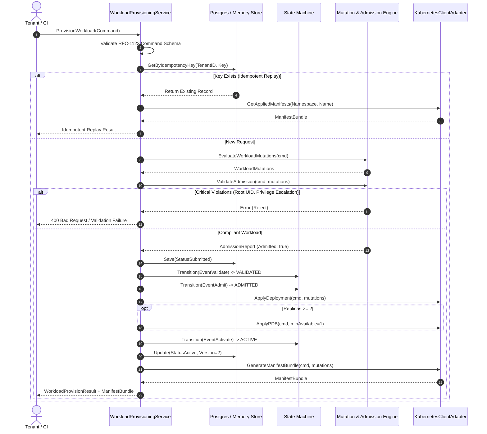

# Kubernetes Workload Provisioning: Architecture & Execution Guide

## 1. Overview & Execution Model
The `kubernetes-workload-provisioning` feature serves as the core admission and manifest generation engine for the **Workload API** (Domain 4.3). It transforms incoming tenant provisioning commands into RFC-compliant, CIS GKE-hardened Kubernetes manifests while enforcing immutable institutional security invariants.



---

## 2. The 6 Generated Kubernetes Resources

Every admitted workload produces a cohesive, self-contained `ManifestBundle` containing six declarative Kubernetes objects:

### 2.1 Tenant Namespace
Enforces Kubernetes Pod Security Standards at the namespace boundary and configures Cloud Service Mesh managed sidecar injection:
- **Labels Applied**:
  - `pod-security.kubernetes.io/enforce: restricted`
  - `pod-security.kubernetes.io/audit: restricted`
  - `pod-security.kubernetes.io/warn: restricted`
  - `istio.io/rev: asm-managed`
  - `app.kubernetes.io/part-of: <TenantID>`
  - `app.kubernetes.io/managed-by: internal-developer-platform`

### 2.2 Namespace ResourceQuota
Prevents noisy-neighbor resource starvation across multi-tenant clusters:
- `requests.cpu: 10`
- `requests.memory: 20Gi`
- `limits.cpu: 20`
- `limits.memory: 40Gi`
- `pods: 50`

### 2.3 Namespace LimitRange
Injects baseline container floors if a developer omits specific resource fields:
- Container Default Limit: `1000m` CPU, `1Gi` Memory
- Container Default Request: `250m` CPU, `256Mi` Memory

### 2.4 Default-Deny NetworkPolicy
Enforces zero-trust east-west network isolation:
- Blocks all unapproved ingress and egress traffic by default.
- Explicitly opens UDP/TCP port 53 for cluster DNS queries (`kube-dns`).

### 2.5 Hardened Deployment
Enforces CIS GKE security benchmarks:
- **Pod Security Context**:
  - `runAsNonRoot: true`
  - `runAsUser: 10001` (UID > 0)
  - `runAsGroup: 10001`
  - `seccompProfile: { type: "RuntimeDefault" }`
- **Container Security Context**:
  - `allowPrivilegeEscalation: false`
  - `readOnlyRootFilesystem: true`
  - `capabilities.drop: ["ALL"]`
- **Probes**:
  - `startupProbe`: HTTP `/readyz` on port 8080
  - `livenessProbe`: HTTP `/livez` on port 8080
  - `readinessProbe`: HTTP `/readyz` on port 8080

### 2.6 PodDisruptionBudget (PDB)
Automatically generated whenever `replicas >= 2` to guarantee high availability during node drain or cluster rolling upgrades:
- `minAvailable: 1`

---

## 3. Admission & Invariant Enforcement Matrix

| Invariant | Enforced By | Result on Failure |
|---|---|---|
| **Non-Root Execution** | `rules.ValidateAdmission` | Hard Failure (`SEC-001`). Immediate rejection. |
| **No Privilege Escalation** | `rules.ValidateAdmission` | Hard Failure (`SEC-002`). Immediate rejection. |
| **Read-Only Root Filesystem** | `rules.ValidateAdmission` | Hard Failure (`SEC-003`). Immediate rejection. |
| **Multi-Replica PDB Guard** | `rules.ValidateAdmission` | Hard Failure (`REL-001`). Immediate rejection. |
| **Immutable Image Tags** | `rules.ValidateAdmission` | Warning Violation (`IMG-001`). Flagged in `AdmissionReport`. |
| **Idempotent Replay** | `store.GetByIdempotencyKey` | Idempotent replay; returns existing record & bundle. |

---

## 4. Programmatic Usage Example

```go
package main

import (
	"context"
	"fmt"

	idp "internal-developer-platform/src/features/kubernetes-workload-provisioning"
)

func main() {
	ctx := context.Background()

	// 1. Initialize repository store and Kubernetes adapter
	store := idp.NewMemoryStore()
	k8sClient := idp.NewK8sClient("https://10.0.0.1:6443")
	svc := idp.NewService(store, k8sClient)

	// 2. Submit compliant workload provisioning command
	cmd := idp.Command{
		ID:             "wkld-order-service-01",
		TenantID:       "ecommerce",
		ServiceID:      "order-processor",
		Namespace:      "ecommerce-prod",
		WorkloadName:   "order-api",
		Image:          "gcr.io/company/order:v1.2.0",
		CPURequest:     "500m",
		CPULimit:       "2000m",
		MemoryRequest:  "512Mi",
		MemoryLimit:    "2Gi",
		Replicas:       3,
		IdempotencyKey: "tx-order-001",
	}

	result, err := svc.ProvisionWorkload(ctx, cmd)
	if err != nil {
		panic(err)
	}

	fmt.Printf("Workload Status: %s\n", result.Provision.Status)
	fmt.Printf("PDB Created: %t\n", result.PDBCreated)
	fmt.Printf("Generated Deployment YAML:\n%s\n", result.Manifests.DeploymentYAML)
}
```
