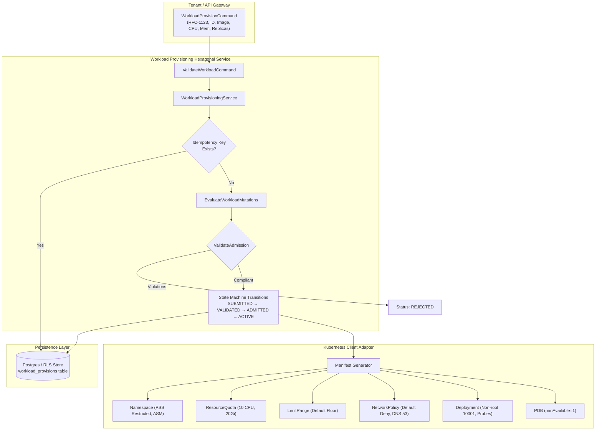
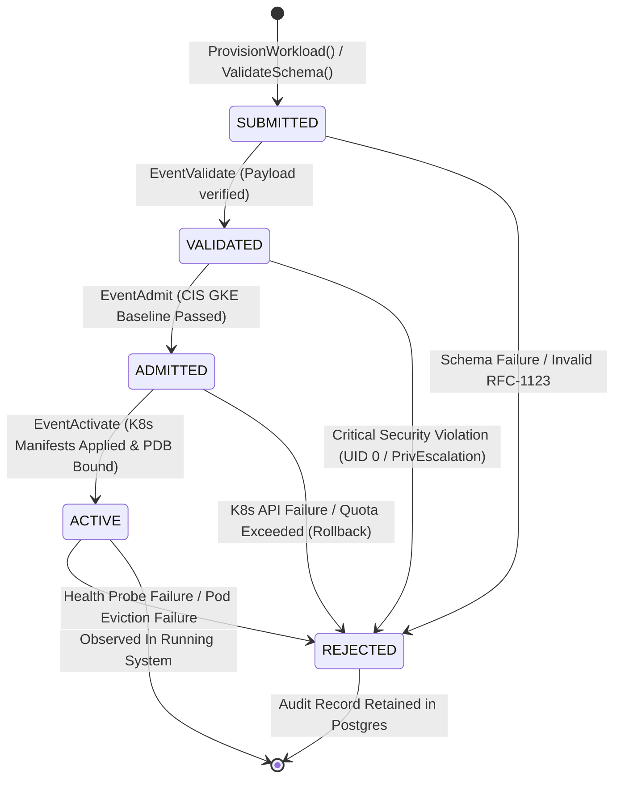
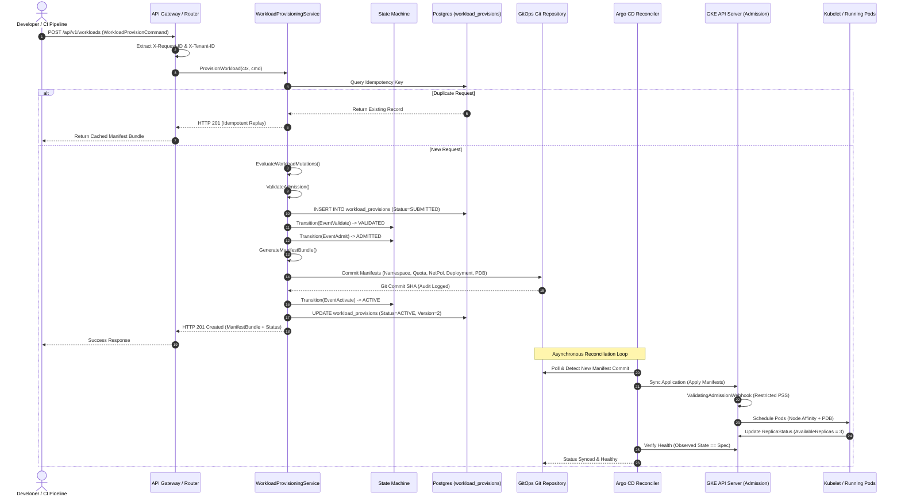
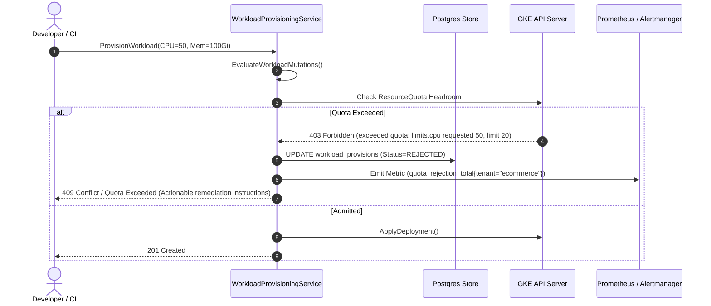

# Architecture & Operational Diagrams: Kubernetes Workload Provisioning

This document visualizes the complete end-to-end lifecycle, finite state transitions, multi-tenant network isolation boundaries, and failure mitigation paths for the Workload Provisioning Engine.

---

## 1. High-Level Component Architecture Flow



---

## 2. Finite State Machine (FSM) Lifecycle & Rollback

Tracks the transition of every provision record from initial command receipt to observed cluster health. Any fatal error triggers immediate rollback to `REJECTED` and version increment to preserve the audit trail.



---

## 3. End-to-End GitOps & Admission Webhook Pipeline

Shows the complete control loop spanning the Workload API, Git repository, Argo CD, Kubernetes API Server, and admission verification:



---

## 4. Multi-Tenant Cluster Namespace Isolation Topology

Visualizes how every workload is partitioned within its dedicated namespace with default-deny networking, restricted security contexts, and resource quotas:

```mermaid
flowchart TD
    subgraph Cluster["GKE Multi-Tenant Cluster"]
        subgraph NS["Tenant Namespace: payments-prod"]
            direction TB
            
            subgraph Policies["Boundary Policies"]
                PSS["PSS: pod-security.kubernetes.io/enforce=restricted"]
                ASM["Service Mesh: istio.io/rev=asm-managed (mTLS STRICT)"]
                RQ["ResourceQuota: 10 CPU / 20Gi Mem / 50 Pods"]
                LR["LimitRange: Container Floors"]
            end
            
            subgraph NetPol["Zero-Trust NetworkPolicy"]
                DENY_IN["Default Deny Ingress"]
                DENY_EG["Default Deny Egress"]
                ALLOW_DNS["Allow UDP/TCP 53 to kube-dns"]
            end
            
            subgraph Workload["Payment Workload"]
                DEP["Deployment: payment-api (replicas=3)"]
                PDB["PodDisruptionBudget: minAvailable=1"]
                
                subgraph Pod1["Pod 1 (Node A)"]
                    C1["Container: payment-api<br/>UID: 10001 (Non-root)<br/>RootFS: ReadOnly<br/>Drop: ALL<br/>Probes: /readyz, /livez"]
                end
                
                subgraph Pod2["Pod 2 (Node B)"]
                    C2["Container: payment-api<br/>UID: 10001 (Non-root)<br/>RootFS: ReadOnly<br/>Drop: ALL<br/>Probes: /readyz, /livez"]
                end
            end
            
            Policies -.-> Workload
            NetPol -.-> Workload
            DEP --> Pod1
            DEP --> Pod2
            PDB -.-> Pod1
            PDB -.-> Pod2
        end
    end
```

---

## 5. Failure Recovery & Quota Exceeded Scenario

Visualizes how the system detects, fails closed, and recovers when a workload exceeds namespace resource limits or fails admission checks:


