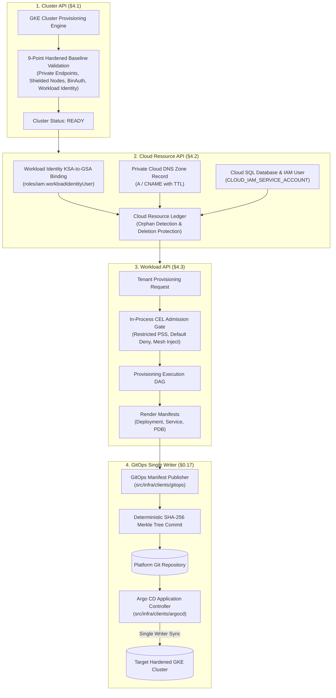
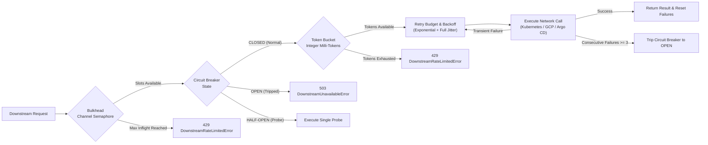
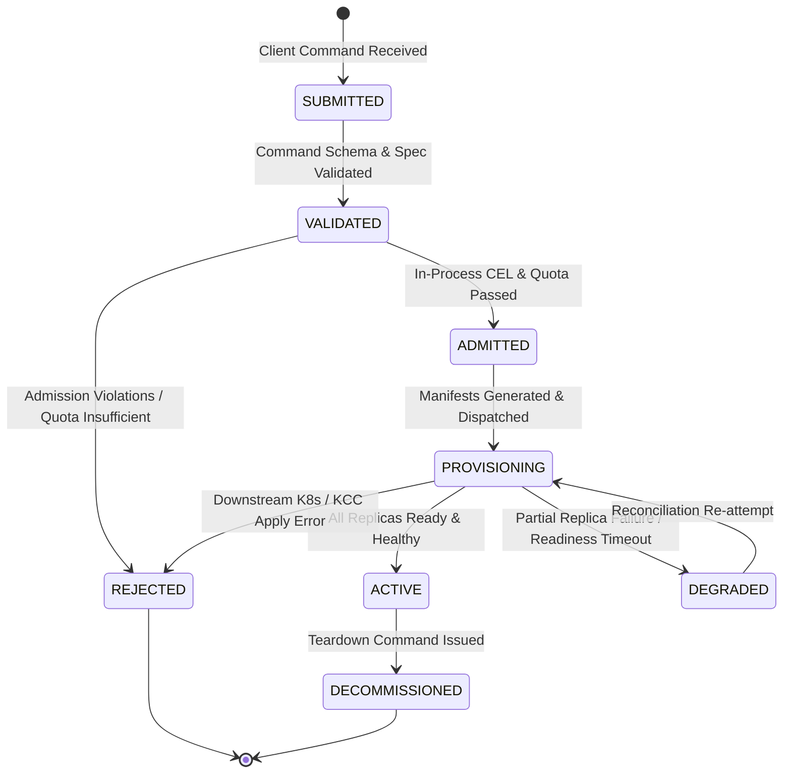
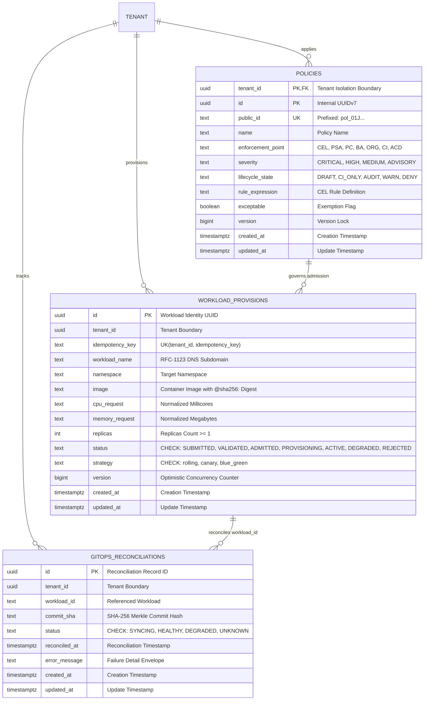

# Architecture & Operational Diagrams: Kubernetes Workload Provisioning

This document provides exhaustive, production-grade architectural diagrams and end-to-end runtime execution trees mapping the complete lifecycle of workload provisioning across our 3-API platform topology.

---

## 1. Complete Runtime Execution ASCII Tree

The following ASCII tree maps the exact invocation sequence of a workload provisioning transaction from edge ingress down to cluster readiness observation:

```text
[HTTP Ingress Gateway] : POST /api/v1/workloads
  │
  ├── 1. Ingress Middleware Pipeline
  │     ├── Extract & Validate W3C Trace Context (traceparent, tracestate)
  │     ├── Ingest Protocol Headers (x-request-id, x-correlation-id, x-tenant-id, x-client-id)
  │     ├── Enforce Ingress Gateway Max Body Size & Closed Schema (additionalProperties: false)
  │     └── Initialize OpenTelemetry Root Server Span: "POST /api/v1/workloads"
  │
  ├── 2. Delivery Handler: WorkloadProvisioningHandler.Handle()
  │     ├── Deserialize JSON Request DTO → contracts.WorkloadProvisionCommand
  │     ├── Open Internal Child Span: "kubernetes.workload.provision"
  │     └── Invoke Domain Service: WorkloadProvisioningService.ProvisionWorkload(ctx, cmd)
  │
  ├── 3. Workload Provisioning Service Execution
  │     │
  │     ├── 3.1 Command Contract Validation
  │     │     ├── Child Span: "kubernetes.workload.validate_command"
  │     │     ├── Verify RFC-1123 DNS Subdomain Names (workload_name, namespace)
  │     │     ├── Verify Positive Integer Replicas & Immutable Image Digest
  │     │     └── ⚠ On Failure: RecordError(span, err) → Return 400 ValidationError
  │     │
  │     ├── 3.2 Root-Cause Idempotency Check
  │     │     ├── Child Span: "kubernetes.workload.idempotency_lookup"
  │     │     ├── Query Postgres: SELECT * FROM workload_provisions WHERE tenant_id = :t AND idempotency_key = :k
  │     │     └── ↳ If Exists: Return Cached Record (Idempotent 200 OK)
  │     │
  │     ├── 3.3 Mutation Evaluation
  │     │     ├── Child Span: "kubernetes.workload.evaluate_mutations"
  │     │     ├── Calculate CPU Request/Limit Headroom & Memory Ratio
  │     │     ├── Determine PodDisruptionBudget requirement (minAvailable=1 if replicas >= 2)
  │     │     └── Inject Managed Cloud Service Mesh Annotations ("sidecar.istio.io/inject": "true")
  │     │
  │     ├── 3.4 Namespace Quota Headroom Verification
  │     │     ├── Child Span: "kubernetes.workload.verify_quota_headroom"
  │     │     ├── Downstream K8s Call: k8sClient.GetNamespaceQuota(ctx, namespace)
  │     │     ├── Evaluate: headroom.RemainingCPU >= requiredCPU && headroom.RemainingMem >= requiredMem
  │     │     └── ⚠ On Insufficient Quota: RecordError(span, quotaErr) → Return 409 ConflictError
  │     │
  │     ├── 3.5 In-Process CEL Admission Policy Gate
  │     │     ├── Child Span: "kubernetes.workload.validate_admission"
  │     │     ├── Delegate to CELEvaluator.Evaluate(ctx, admissionInput)
  │     │     │     ├── Evaluate Rule 1: Restricted Pod Security Standard (runAsNonRoot, drop ALL caps)
  │     │     │     ├── Evaluate Rule 2: Cloud Service Mesh Injection Mandatory
  │     │     │     ├── Evaluate Rule 3: Namespace Default-Deny NetworkPolicy Enforced
  │     │     │     ├── Evaluate Rule 4: Immutable @sha256: Image Digest Pinned
  │     │     │     ├── Evaluate Rule 5: Mandatory Governance Labels Present (request-id, owner, cost-center)
  │     │     │     └── Evaluate Rule 6: Disallow Privileged Containers
  │     │     └── ⚠ On Violation: RecordError(span, err) → Transition FSM to REJECTED → Return 422 UnprocessableEntity
  │     │
  │     ├── 3.6 Provisioning DAG Execution
  │     │     ├── Child Span: "kubernetes.workload.dag.execute"
  │     │     ├── Step 1: Validate Spec Blueprint
  │     │     ├── Step 2: Apply Evaluated Mutations
  │     │     ├── Step 3: Verify Resource Quotas
  │     │     └── Step 4: Generate K8s Spec Manifests (Deployment, Service, PDB)
  │     │
  │     ├── 3.7 Initial State Persistence
  │     │     ├── Child Span: "kubernetes.workload.db_insert"
  │     │     └── SQL Insert: INSERT INTO workload_provisions (status = 'SUBMITTED', version = 1)
  │     │
  │     ├── 3.8 State Machine Transition: SUBMITTED → VALIDATED → ADMITTED → PROVISIONING
  │     │     ├── Child Span: "kubernetes.workload.state_machine_transition"
  │     │     └── Enforce Strict State Matrix & Transition Guards
  │     │
  │     ├── 3.9 Downstream Resilient Kubernetes / GitOps Application
  │     │     ├── Child Span: "kubernetes.workload.apply_deployment"
  │     │     ├── Acquire Bulkhead Slot (MaxInflight Concurrency Semaphore)
  │     │     ├── Verify Circuit Breaker State (CLOSED)
  │     │     ├── Deduct Integer Milli-Tokens from Rate Limiter Bucket
  │     │     ├── Execute k8sClient.ApplyDeployment(ctx, cmd, mutations)
  │     │     └── ↳ If mutations.PDBRequired: Execute k8sClient.ApplyPDB(ctx, ns, name, minAvailable)
  │     │
  │     ├── 3.10 Cluster Readiness Observation
  │     │     ├── Child Span: "kubernetes.workload.observe_readiness"
  │     │     ├── Poll Pod Status: readyReplicas == desiredReplicas && endpointsAvailable
  │     │     ├── ↳ If Ready: FSM Transition → 'ACTIVE' (Version = 2)
  │     │     └── ↳ If Degraded/Timeout: FSM Transition → 'DEGRADED' (Version = 2)
  │     │
  │     └── 3.11 Final Audit Persistence & Response
  │           ├── Update Database: UPDATE workload_provisions SET status = :s, version = 2 WHERE id = :id AND version = 1
  │           └── Return 201 Created Enveloped Response with WorkloadProvisionResponse DTO
```

---

## 2. Cross-API Platform Lifecycle Ordering

The platform enforces a strict unidirectional dependency hierarchy. Workloads cannot be deployed until their parent cluster is hardened and dependent cloud resources are provisioned:



---

## 3. Downstream Client Resilience Architecture

All downstream network communication with Kubernetes API servers, GCP services, and Argo CD traverses our resilient execution chassis:



---

## 4. Finite State Machine (FSM) Transition Diagram

Every workload provision record transitions through an audited finite state machine with optimistic locking:



---

## 5. Platform Cross-Feature Entity-Relationship (ER) Architecture

The platform links tenant workloads, GitOps reconciliation audits, and security policies across a unified multi-tenant relational boundary:



### Criticality Rationale: Why Cross-Feature Relational Integrity Is Essential

1. **Root-Cause Idempotency & Race Condition Prevention**:
   - The unique constraint `UNIQUE (tenant_id, idempotency_key)` on `workload_provisions` guarantees mutation safety at the database engine level. Duplicate HTTP POST requests from flaky networks are neutralized before any Kubernetes or GitOps write occurs.
2. **Cryptographic Traceability from Spec to Cluster State**:
   - Linking `workload_provisions` to `gitops_reconciliations` via `commit_sha` ensures that every running container in the GKE cluster can be traced back to its exact Git commit hash, its triggering API request ID, and the governing policy set.
3. **Optimistic Locking Guardrails**:
   - The `version BIGINT` column on all stateful tables prevents lost updates during concurrent scale or rollout commands (`WHERE id = :id AND version = :version`), strictly conforming to Guardrail 7 of `2-apis.writing.rule.md`.
