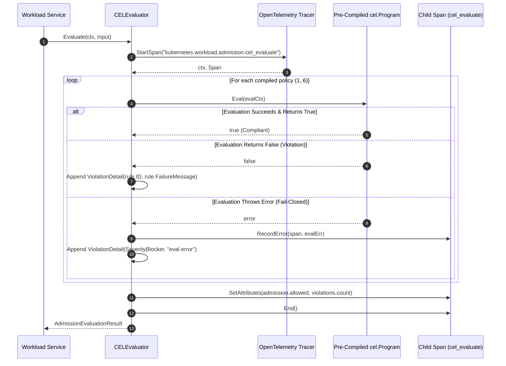
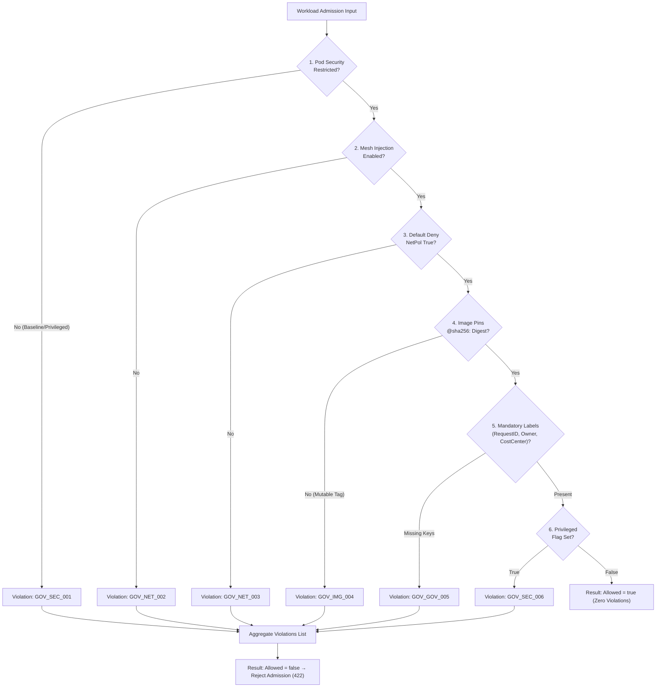

# Architecture & Operational Diagrams: Policy as Code

This document details the runtime architecture, compiled Common Expression Language (CEL) evaluation pipeline, fail-closed policy execution trees, and distributed tracing telemetry hierarchies for the Policy as Code engine.

---

## 1. CEL Policy Engine Runtime Execution ASCII Tree

The following ASCII tree illustrates the two-phase lifecycle of the CEL admission policy engine: from boot-time AST compilation down to sub-millisecond per-request evaluation:

```text
[Engine Boot Phase] : NewDefaultGovernmentCELEvaluator()
  │
  ├── 1. Initialize CEL Environment (cel.NewEnv)
  │     ├── Declare Variables with Strict Static Types:
  │     │     ├── VarPodSecurityLevel  : cel.StringType ("pod_security_level")
  │     │     ├── VarMeshInjection     : cel.BoolType   ("mesh_injection")
  │     │     ├── VarDefaultDenyNetPol : cel.BoolType   ("default_deny_netpol")
  │     │     ├── VarImage             : cel.StringType ("image")
  │     │     ├── VarPrivileged        : cel.BoolType   ("privileged")
  │     │     ├── VarLabels            : cel.MapType(cel.StringType, cel.StringType)
  │     │     └── VarAnnotations       : cel.MapType(cel.StringType, cel.StringType)
  │     └── ⚠ On Environment Creation Failure: Return Fatal Startup Error
  │
  └── 2. Immutable AST Compilation Loop
        ├── For each rule in DefaultGovernmentPolicies:
        │     ├── Compile Expression: env.Compile(rule.Expression)
        │     ├── Verify Syntax & Type Safety (iss.Err() == nil)
        │     ├── Generate Evaluation Program: env.Program(ast)
        │     └── Cache in Memory: compiledRule{rule, program}
        └── Pre-compiled Programs Ready for Zero-Allocation Runtime Ingestion

─────────────────────────────────────────────────────────────────────────────

[Per-Request Ingestion Phase] : CELEvaluator.Evaluate(ctx, input)
  │
  ├── 1. Distributed Tracing Initialization
  │     ├── Open OTel Child Span: "kubernetes.workload.admission.cel_evaluate"
  │     ├── Set Attributes: workload.name, namespace
  │     └── Defer span.End()
  │
  ├── 2. Evaluation Context Construction
  │     ├── Normalize Labels & Annotations (Prevent Nil Map Panics)
  │     └── Build Runtime Context Map:
  │           {
  │             "pod_security_level":  input.PodSecurityLevel,
  │             "mesh_injection":      input.MeshInjection,
  │             "default_deny_netpol": input.DefaultDenyNetPol,
  │             "image":               input.Image,
  │             "privileged":          input.Privileged,
  │             "labels":              input.Labels,
  │             "annotations":         input.Annotations
  │           }
  │
  ├── 3. Sequential Compiled Rule Evaluation
  │     │
  │     ├── 3.1 Rule: GOV_SEC_001_POD_SECURITY_RESTRICTED
  │     │     ├── Eval: pod_security_level == 'restricted'
  │     │     └── ↳ If False: Append ViolationDetail(SeverityBlocker)
  │     │
  │     ├── 3.2 Rule: GOV_NET_002_MESH_INJECTION_MANDATORY
  │     │     ├── Eval: mesh_injection == true
  │     │     └── ↳ If False: Append ViolationDetail(SeverityBlocker)
  │     │
  │     ├── 3.3 Rule: GOV_NET_003_DEFAULT_DENY_NETPOL
  │     │     ├── Eval: default_deny_netpol == true
  │     │     └── ↳ If False: Append ViolationDetail(SeverityBlocker)
  │     │
  │     ├── 3.4 Rule: GOV_IMG_004_IMMUTABLE_IMAGE_DIGEST
  │     │     ├── Eval: image.contains('@sha256:')
  │     │     └── ↳ If False: Append ViolationDetail(SeverityBlocker)
  │     │
  │     ├── 3.5 Rule: GOV_GOV_005_MANDATORY_GOVERNANCE_LABELS
  │     │     ├── Eval: 'platform.gov/request-id' in labels && 'platform.gov/owner' in labels && 'platform.gov/cost-center' in labels
  │     │     └── ↳ If False: Append ViolationDetail(SeverityCritical)
  │     │
  │     └── 3.6 Rule: GOV_SEC_006_PRIVILEGED_CONTAINER_DISALLOWED
  │           ├── Eval: !privileged
  │           └── ↳ If False: Append ViolationDetail(SeverityBlocker)
  │
  ├── 4. Fail-Closed Error Handling & Origin Telemetry Stamping
  │     ├── If Program.Eval() Returns Non-Nil Error:
  │     │     ├── Immediately Invoke: observability.RecordError(span, evalErr)
  │     │     └── Treat as Violation: Append ViolationDetail("evaluation error: ...")
  │     │
  │     └── If len(violations) > 0:
  │           ├── Mark Result: Allowed = false
  │           ├── Stamp Span Attribute: admission.allowed = false
  │           └── Stamp Span Attribute: admission.violations.count = N
  │
  └── 5. Result Envelope Return
        └── Return &AdmissionEvaluationResult{Allowed, Violations, EvaluatedCount: 6}
```

---

## 2. In-Process Admission Evaluation Sequence Diagram



---

## 3. Fail-Closed Policy Enforcement Partition

Every incoming workload spec is partitioned into compliant or rejected regions based on our 6-point government baseline:


