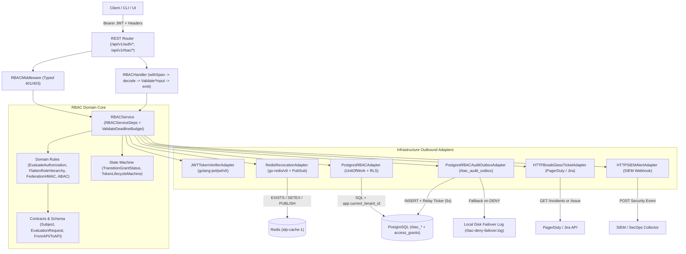
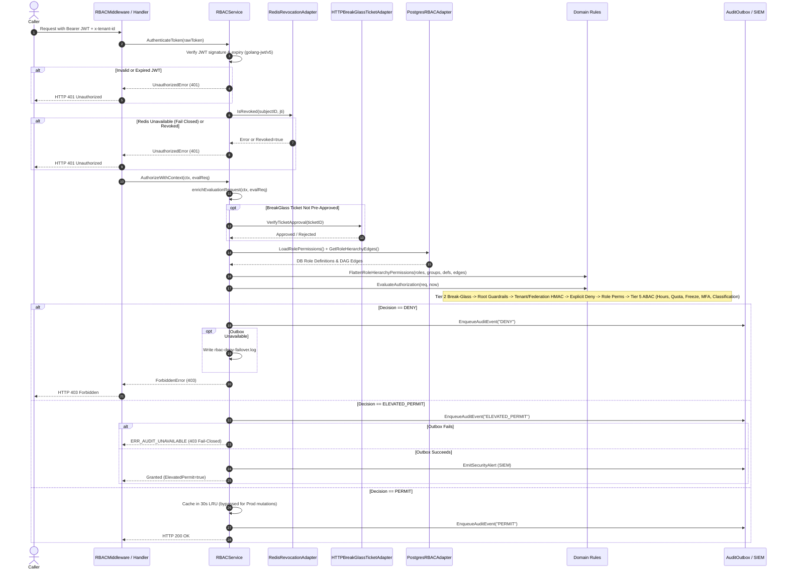
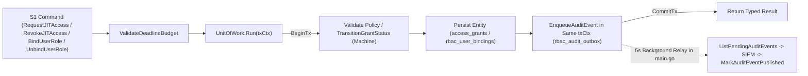

# RBAC & Authorization Architecture Diagrams and Usage Guide

## 1. High-Level Hexagonal Architecture



---

## 2. 6-Tier Authorization, Break-Glass & Audit Sequence



---

## 3. S1 Command UnitOfWork & Outbox Relay Flow



---

## 4. In-Depth Usage & Operations Guide

### 4.1 Configuration & Secrets (`config/default.yaml` & Environment Overrides)
All external endpoints and secrets are loaded via `src/infra/config/config.go` (`AppConfig.RBAC`). Leave tokens empty in `config/default.yaml` and inject them via environment variables in production:

| Environment Variable | Config Path | Purpose |
|---|---|---|
| `JWT_SECRET` | `auth.jwt_secret` | HS256 signing key (min 16 chars; adapter fails closed if empty) |
| `AUTH_ISSUER` | `auth.issuer` | Expected JWT `iss` claim |
| `REDIS_ADDR` | `redis.address` | Redis host:port for revocation & `rbac:cache:invalidate` Pub/Sub |
| `DATABASE_URL` | `database.url` | PostgreSQL DSN (required at boot; no memory fallback) |
| `PAGERDUTY_ENDPOINT` | `rbac.pagerduty_endpoint` | PagerDuty API base URL for `PD-*` break-glass tickets |
| `PAGERDUTY_API_TOKEN` | `rbac.pagerduty_api_token` | PagerDuty REST token (`Token token=...`) |
| `JIRA_ENDPOINT` | `rbac.jira_endpoint` | Jira API base URL for non-`PD-*` break-glass tickets |
| `JIRA_API_TOKEN` | `rbac.jira_api_token` | Jira Bearer API token |
| `SIEM_WEBHOOK_URL` | `rbac.siem_webhook_url` | SIEM HTTP collector URL for break-glass & outbox relay |
| `SIEM_API_TOKEN` | `rbac.siem_api_token` | SIEM Bearer token |
| `RBAC_FEDERATION_HMAC_SECRET` | `rbac.federation_hmac_secret` | Shared HMAC-SHA256 secret for cross-tenant federation handshakes |

Additional static defaults in `config/default.yaml` under `rbac:`:
- `abac_allowed_start_hour_utc: 0` and `abac_allowed_end_hour_utc: 24` (set e.g. `8` to `20` to enforce UTC business-hours access).
- `dev_staging_max_quota: 100` (enforced when `targetEnvironment` is `DEV` or `STAGING`).

### 4.2 Database Migrations & RLS Setup
Apply the RBAC migrations in order (`0002_create_rbac_tables.sql`, `0011_create_access_grants_table.sql`, `0020_create_rbac_audit_outbox.sql`, `0021_harden_rbac_schema.sql`), then apply `database/config/rls.sql`. Ensure your PostgreSQL transaction runner sets `app.current_tenant_id` per transaction so RLS policies on `rbac_user_bindings`, `access_grants`, and `rbac_audit_outbox` allow tenant-scoped queries.

### 4.3 API Usage Examples (`curl`)

#### 1. Issue a JWT with Extended Claims
```bash
curl -X POST http://127.0.0.1:8080/api/v1/auth/token \
  -H "Content-Type: application/json" \
  -d '{
    "subjectId": "usr_101",
    "tenantId": "tenant-alpha",
    "roles": ["Developer"],
    "groupMemberships": ["TeamLead"],
    "clientType": "cli",
    "mfaVerified": true,
    "classification": "confidential",
    "ttlSeconds": 3600
  }'
```

#### 2. Standard RBAC + ABAC Authorization Check
```bash
curl -X POST http://127.0.0.1:8080/api/v1/rbac/authorize \
  -H "Authorization: Bearer <JWT>" \
  -H "Content-Type: application/json" \
  -H "x-tenant-id: tenant-alpha" \
  -d '{
    "targetTenantId": "tenant-alpha",
    "resource": "service-catalog",
    "action": "write",
    "targetEnvironment": "PRODUCTION",
    "changeFreezeActive": false,
    "requireStepUpMfa": true,
    "resourceClassification": "confidential"
  }'
```

#### 3. Emergency Break-Glass Authorization (Tier-0 Prod)
If `ticketApproved` is `false`, `RBACService` verifies `ticketId` against `HTTPBreakGlassTicketAdapter` (PagerDuty for `PD-*` IDs, Jira otherwise), enforces `ttlSeconds <= 7200` and `dualApprovalGranted: true` for `tier0Prod: true`, persists `ELEVATED_PERMIT` to `rbac_audit_outbox`, and emits a SIEM alert.
```bash
curl -X POST http://127.0.0.1:8080/api/v1/rbac/authorize \
  -H "Authorization: Bearer <JWT>" \
  -H "Content-Type: application/json" \
  -d '{
    "targetTenantId": "tenant-alpha",
    "resource": "infrastructure",
    "action": "delete",
    "targetEnvironment": "PRODUCTION",
    "breakGlass": {
      "ticketId": "PD-99124",
      "ticketApproved": false,
      "ttlSeconds": 1800,
      "tier0Prod": true,
      "dualApprovalGranted": true
    }
  }'
```

#### 4. Cross-Tenant Federation Handshake
Compute `signature = hex(HMAC_SHA256(RBAC_FEDERATION_HMAC_SECRET, "<sourceTenantId>|<targetTenantId>|<expiresAtUnix>"))`:
```bash
curl -X POST http://127.0.0.1:8080/api/v1/rbac/authorize \
  -H "Authorization: Bearer <JWT>" \
  -H "Content-Type: application/json" \
  -d '{
    "targetTenantId": "tenant-beta",
    "resource": "service-catalog",
    "action": "read",
    "crossTenantFederation": {
      "sourceTenantId": "tenant-alpha",
      "targetTenantId": "tenant-beta",
      "expiresAtUnix": 1893456000,
      "signature": "<hmac-sha256-hex>"
    }
  }'
```

#### 5. Bind User Role & Validate Role Hierarchy DAG
```bash
curl -X POST http://127.0.0.1:8080/api/v1/auth/bindings \
  -H "Authorization: Bearer <ADMIN_JWT>" \
  -H "Content-Type: application/json" \
  -d '{"subjectId": "usr_101", "tenantId": "tenant-alpha", "roleName": "Developer"}'

curl -X POST http://127.0.0.1:8080/api/v1/rbac/roles/validate-hierarchy \
  -H "Authorization: Bearer <ADMIN_JWT>" \
  -H "Content-Type: application/json" \
  -d '{"edges": {"PlatformAdmin": ["Developer"], "Developer": ["Viewer"]}}'
```

#### 6. JIT Access Grant Lifecycle & Session/JTI Revocation
```bash
curl -X POST http://127.0.0.1:8080/api/v1/auth/jit/grants \
  -H "Authorization: Bearer <ADMIN_JWT>" \
  -H "Content-Type: application/json" \
  -d '{
    "id": "grant-001",
    "tenantId": "tenant-alpha",
    "subjectId": "usr_101",
    "targetNamespace": "prod-payments",
    "role": "Developer",
    "reason": "INC-4421 database failover investigation",
    "durationSeconds": 1800,
    "approverRole": "PlatformAdmin",
    "idempotencyKey": "idem-grant-001"
  }'

curl -X POST http://127.0.0.1:8080/api/v1/auth/jit/grants/grant-001/revoke \
  -H "Authorization: Bearer <ADMIN_JWT>" \
  -H "x-tenant-id: tenant-alpha"

curl -X POST http://127.0.0.1:8080/api/v1/auth/revoke \
  -H "Authorization: Bearer <ADMIN_JWT>" \
  -H "Content-Type: application/json" \
  -d '{"subjectId": "usr_101", "jti": "tok-jti-123", "reason": "offboarding"}'
```
