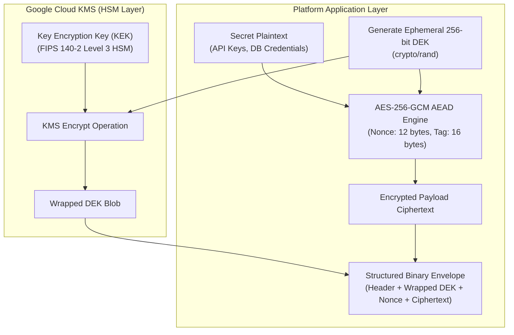
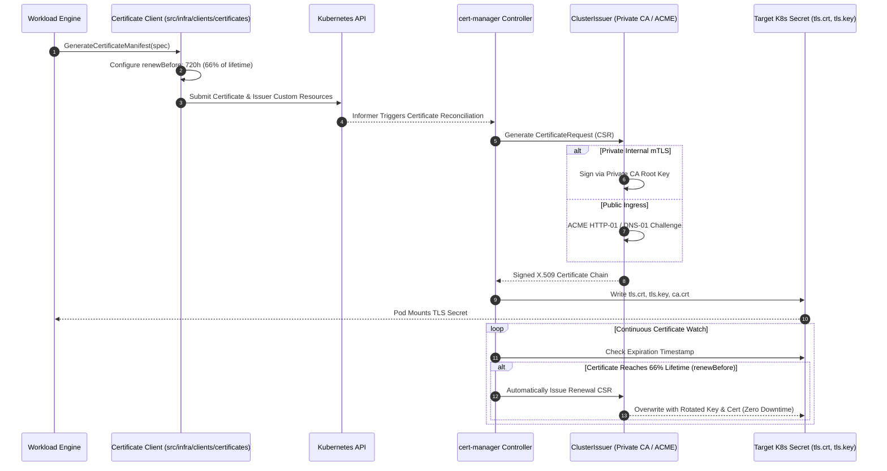

# Architecture & Operational Diagrams: Secrets Management & Cryptography

This document details the runtime architecture of application-layer Customer-Managed Encryption Key (CMEK) envelope encryption and declarative PKI certificate lifecycles via `cert-manager.io/v1`.

---

## 1. CMEK Envelope Encryption & Decryption Runtime Execution ASCII Tree

The following ASCII tree outlines the two-tier envelope encryption process (AES-256-GCM + Google Cloud KMS) executed by `src/infra/clients/kms/`:

```text
[Secret Encryption Pipeline] : EnvelopeEncryptionEngine.Encrypt(ctx, plaintext)
  │
  ├── 1. Distributed Tracing & Span Setup
  │     ├── Open OTel Child Span: "security.kms.envelope_encrypt"
  │     ├── Set Attributes: key_ring, crypto_key, algorithm ("AES-256-GCM")
  │     └── Defer span.End()
  │
  ├── 2. Ephemeral Data Encryption Key (DEK) Generation
  │     ├── Read 32 cryptographically secure random bytes from crypto/rand
  │     ├── RawDEK = crypto/rand.Read(32 bytes)
  │     └── Ephemeral DEK exists solely in transient memory
  │
  ├── 3. Local Application-Layer AES-256-GCM Encryption
  │     ├── Generate random 12-byte initialization vector (Nonce)
  │     ├── Initialize AES-256 cipher block using RawDEK
  │     ├── Initialize GCM AEAD (Authenticated Encryption with Associated Data)
  │     ├── Encrypt Payload: Ciphertext = GCM.Seal(nil, Nonce, Plaintext, AdditionalAuthData)
  │     └── Note: AuthTag (16 bytes) is appended to Ciphertext by GCM
  │
  ├── 4. Cloud KMS Key Wrapping (KEK)
  │     ├── Call Cloud KMS Encrypt API with Key Encryption Key (KEK):
  │     │     ├── Request: kms.Encrypt(Name: KEK_Resource_Path, Plaintext: RawDEK)
  │     │     └── Response: EncryptedDEK (Ciphertext blob wrapped by KMS HSM)
  │     │
  │     └── Zeroize RawDEK in memory immediately after KMS wrapping
  │
  └── 5. Binary Envelope Packing
        ├── Assemble Structured Binary Envelope:
        │     ├── Magic Byte Header (4 bytes: "CMEK")
        │     ├── Key Version & Metadata (4 bytes)
        │     ├── Length of EncryptedDEK (2 bytes) + EncryptedDEK Payload
        │     ├── Nonce (12 bytes)
        │     └── Ciphertext + GCM Tag
        └── Return Base64-encoded structured envelope for persistent storage

─────────────────────────────────────────────────────────────────────────────

[Secret Decryption Pipeline] : EnvelopeEncryptionEngine.Decrypt(ctx, envelope)
  │
  ├── 1. Envelope Unpacking & Validation
  │     ├── Verify "CMEK" magic header and supported cipher version
  │     └── Extract: EncryptedDEK, Nonce, and Ciphertext
  │
  ├── 2. Cloud KMS Key Unwrapping
  │     ├── Call Cloud KMS Decrypt API:
  │     │     ├── Request: kms.Decrypt(Name: KEK_Resource_Path, Ciphertext: EncryptedDEK)
  │     │     └── Response: Recovered RawDEK (32 bytes)
  │     └── ⚠ On KMS Failure: RecordError(span, err) → Return 403 ForbiddenError
  │
  ├── 3. Local AES-256-GCM Decryption & Authenticated Tag Verification
  │     ├── Initialize GCM AEAD using unwrapped RawDEK
  │     ├── GCM.Open(nil, Nonce, Ciphertext, AdditionalAuthData)
  │     ├── ↳ If AuthTag Mismatch (Tampering / Bit Flip):
  │     │     ├── Panic / Fail-Closed: Return TamperDetectedError
  │     │     └── Zeroize all buffers
  │     │
  │     └── Zeroize RawDEK from memory
  │
  └── 4. Return Decrypted Plaintext Payload
```

---

## 2. CMEK Two-Tier Envelope Encryption Architecture



---

## 3. Cert-Manager Dual-Issuer Automated PKI Lifecycle


