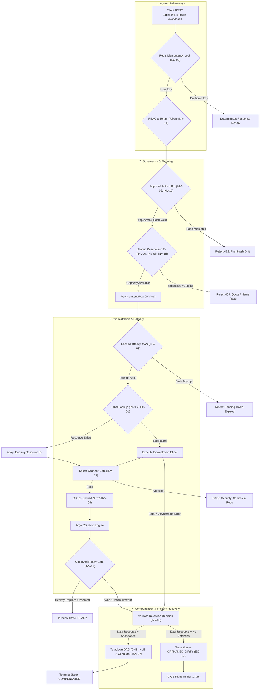
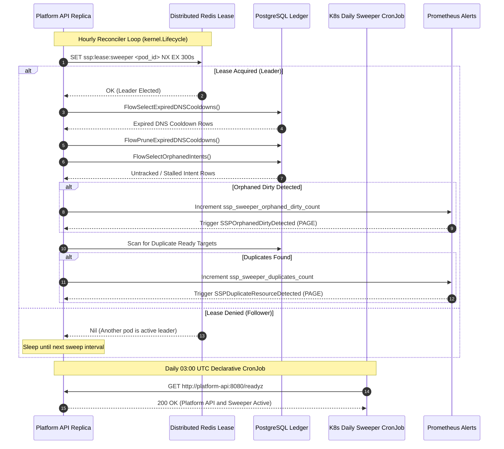
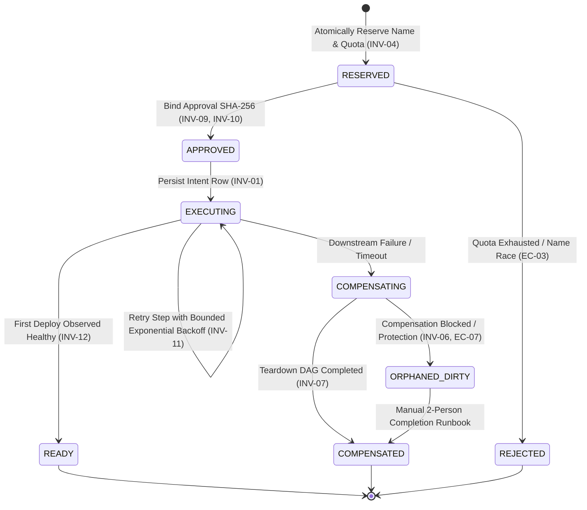
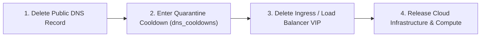
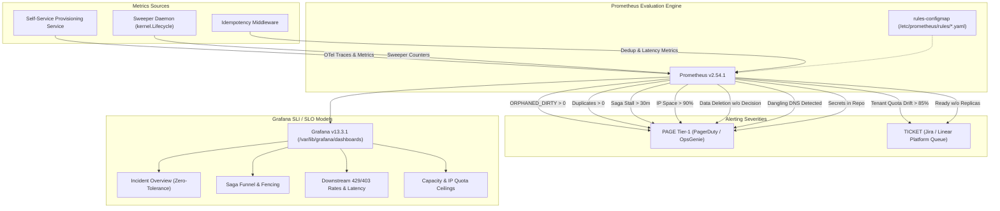

# Architecture Diagrams — Self-Service Provisioning

## 1. End-to-End Self-Service Provisioning Saga Flowchart

---

## 2. Distributed Sweeper Daemon & Leader Lease Architecture (Section C)

---

## 3. Finite State Machine & Lifecycle Transitions

---

## 4. Teardown DAG Strict Ordering (`INV-07`)

---

## 5. Observability & Alert Routing Topology (Section C)

