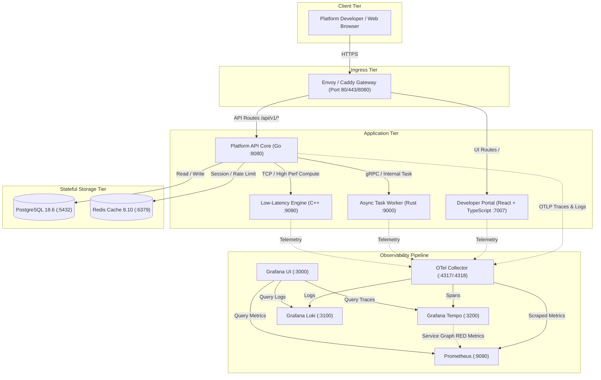
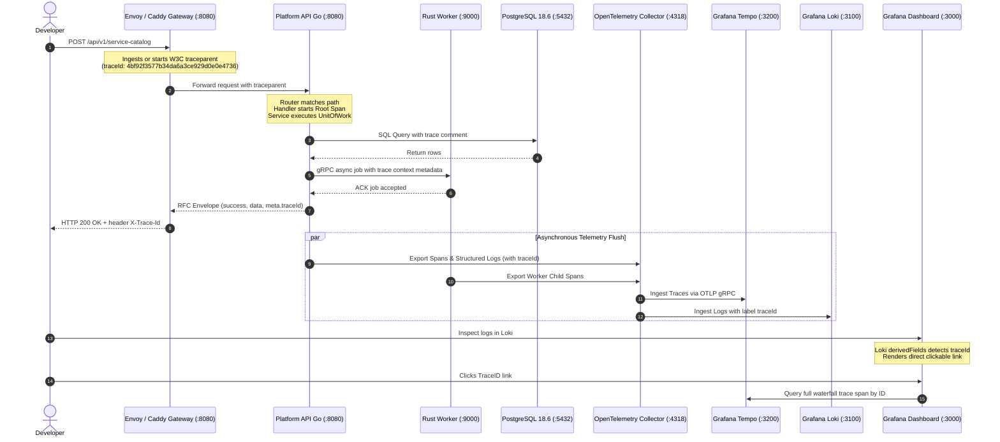
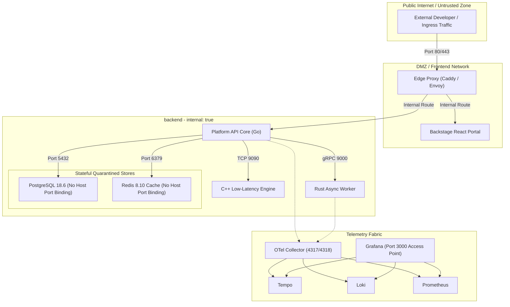

# System Architecture, Distributed Tracing & Service Topography Diagrams

## 1. High-Level Service Interaction Architecture

---

## 2. Distributed Tracing & W3C Context Propagation Sequence

---

## 3. Storage & Network Security Isolation Diagram

